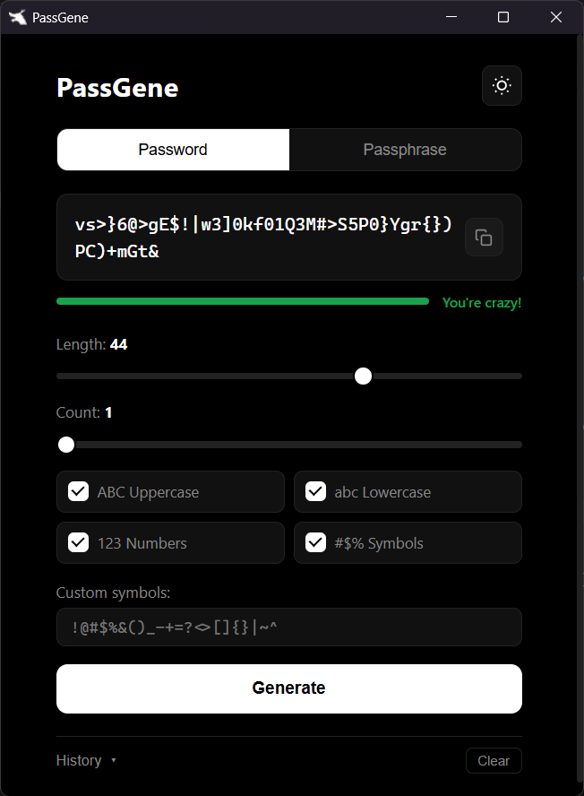
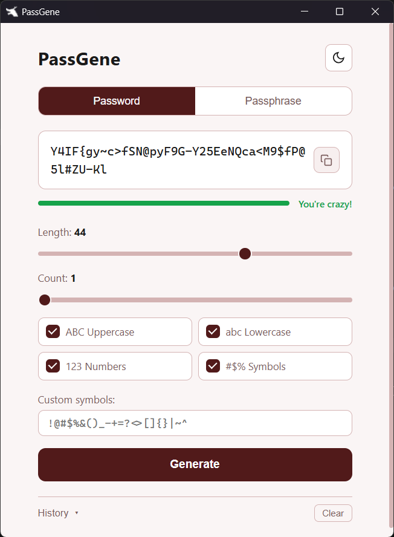

# PassGene v2 - Password & Passphrase Generator

PassGene v2 is a complete rewrite of the original [PassGene](https://github.com/mubakhit/PassGene) Java application. Rebuilt using Tauri (Rust + HTML/CSS/JS) — a modern, lightweight native app with no runtime dependencies.

## Features

- Password & passphrase generation with configurable length
- Toggle character types (uppercase, lowercase, numbers, symbols) and custom symbol sets
- Batch generation (up to 10 at once)
- Strength indicator with visual feedback
- Password history with one-click copy
- Dark & light themes
- Cryptographically secure randomness
- Standalone `.exe` — no Java, Python, or Node needed

## Screenshots




## Installation

Download the latest installer from the [Releases](https://github.com/mubakhit/PassGene/releases) page, or grab the standalone `PassGene.exe`.

## Building from Source

Requires [Rust](https://rustup.rs/) and [Tauri CLI](https://tauri.app/) (`cargo install tauri-cli@^2`).

```bash
cd src-tauri
cargo tauri dev      # development mode
cargo tauri build    # production build
```

## Author

**Muhammad Bakhit** — [GitHub](https://github.com/mubakhit)

## License

This project is open source and available under the [MIT License](LICENSE).
